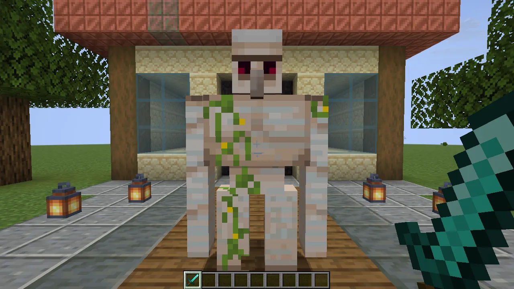
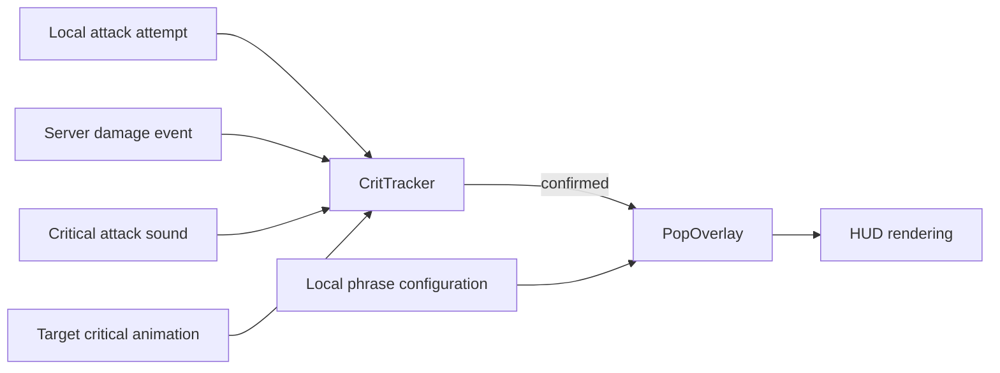

<div align="center">
<h1>Crit Pop</h1>
<hr>
<p><strong>3 signals in one overlay: attempted hits, server confirmation, animated phrases.</strong></p>
<p>


</p>
<p>
<a href="https://github.com/hhhhhffd/CritPop/releases"></a>
<a href="https://github.com/hhhhhffd/CritPop/releases"></a>
<a href="LICENSE"></a>
</p>
<p><a href="https://github.com/hhhhhffd/CritPop/releases">Download</a> · <a href="#architecture">Architecture</a> · <a href="#build">Build</a></p>

</div>

## Overview

Crit Pop is a client-side Minecraft mod that displays colorful animated phrases for confirmed melee critical hits. Phrases scale in, rise and fade in varied upper-screen positions without covering the crosshair. The built-in English phrases and eight placement regions are shuffled without consecutive repeats.

## Technical Stack

| Component | Version / role |
| --- | --- |
| Minecraft Java | 1.21.11 |
| Fabric Loader | 0.18.4 or later |
| Java | 21 or later; build toolchain 21 |
| Fabric Loom / Gradle | 1.13.6 / 9.2.1 |
| Mod Menu | 17 or later, optional settings UI; compiled against 17.0.1 |

## Architecture



- **Correlated evidence:** the tracker requires a local attempt against the living target, a vanilla damage event with the local player as both direct and causing entity, a matching critical-attack sound near the player, and the target's critical animation.
- **Conservative attribution:** misses, ordinary hits, magic-only critical animations, other players' damage, and ambiguous or incomplete sequences do not produce a pop.
- **Client-local presentation:** phrases and placement are selected locally; no chat messages or custom packets are sent.

> [!NOTE]
> Modified servers may suppress or replace vanilla effects. Damage during an invulnerability window can occur without a new damage event, so some genuine hits are deliberately skipped.

## Project Structure

```text
.
├── src/client/          # Tracking, configuration, rendering and mixins
├── src/main/            # Fabric metadata and mixin declarations
├── tests/               # Standalone tracker and placement checks
├── docs/media/          # In-game preview
├── build.gradle         # Loom build configuration
└── gradle.properties    # Minecraft and tool versions
```

## Install and configure

1. Install Fabric Loader 0.18.4 or later for Minecraft Java 1.21.11 and Java 21 or later.
2. Download the [release JAR](https://github.com/hhhhhffd/CritPop/releases) and place it in the client's `mods` folder. Fabric API is not required. The server does not need the mod; integrated servers and ordinary vanilla multiplayer work.
3. Optionally install Mod Menu 17 and use **Mods → Crit Pop → Configure** to enable or disable the effect, add, edit or remove phrases, or reset the defaults. Select **Done** to save.

Alternatively, edit `config/critpop.json` while Minecraft is closed. This is an example, not the complete default phrase list:

```json
{
  "enabled": true,
  "phrases": ["CLEAN CRIT!", "LIGHTS OUT!", "POW!"]
}
```

An empty list disables phrases. At most 64 phrases of 48 characters each are stored; text stays on the client.

## Build

With Java 21, run `./gradlew build` (Windows: `gradlew.bat build`).

<details><summary>Standalone attribution and placement checks</summary>

```sh
javac -d build/critpop-tests src/client/java/com/critpop/CritTracker.java src/client/java/com/critpop/PopPlacement.java tests/CritTrackerTest.java
java -cp build/critpop-tests CritTrackerTest
```
</details>

## Links

- [Releases and downloads](https://github.com/hhhhhffd/CritPop/releases)
- [Source repository](https://github.com/hhhhhffd/CritPop)

## License

[MIT](LICENSE) © 2026 hhhhhffd.
